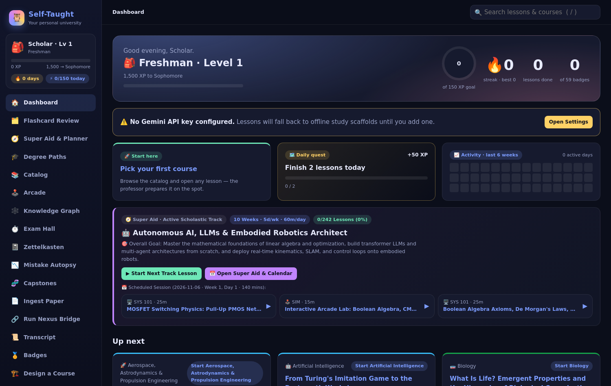
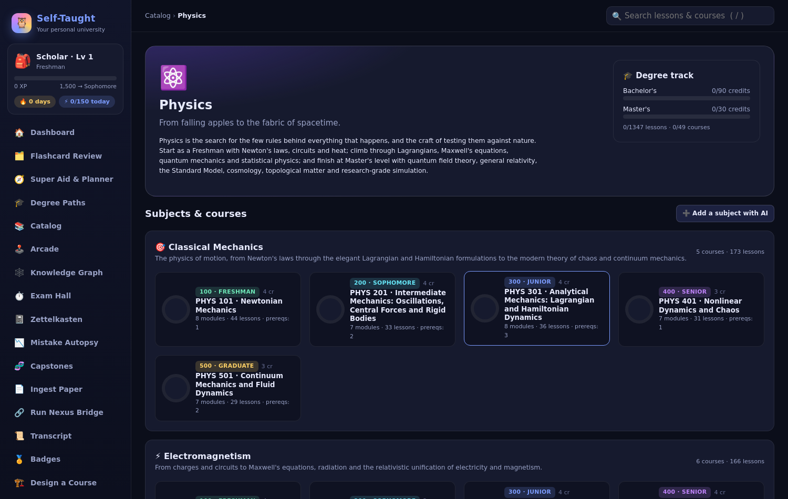
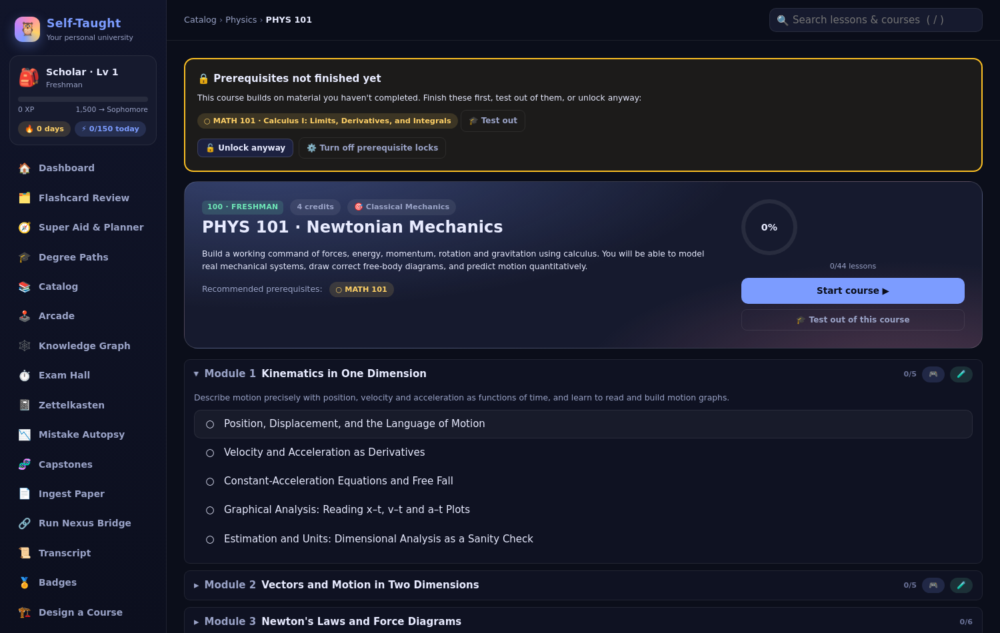
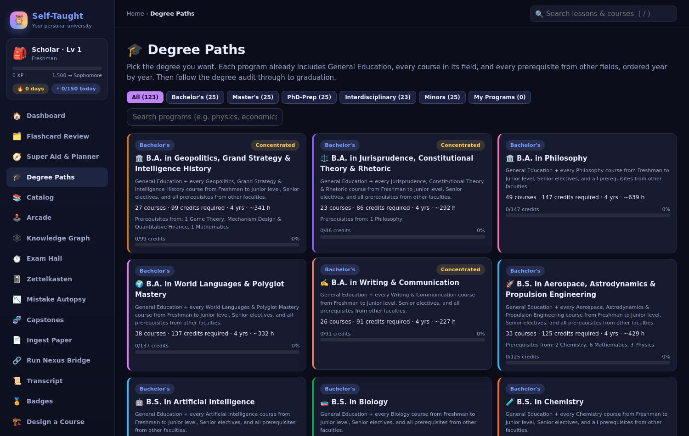
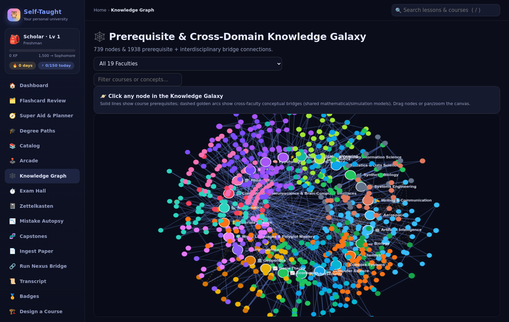
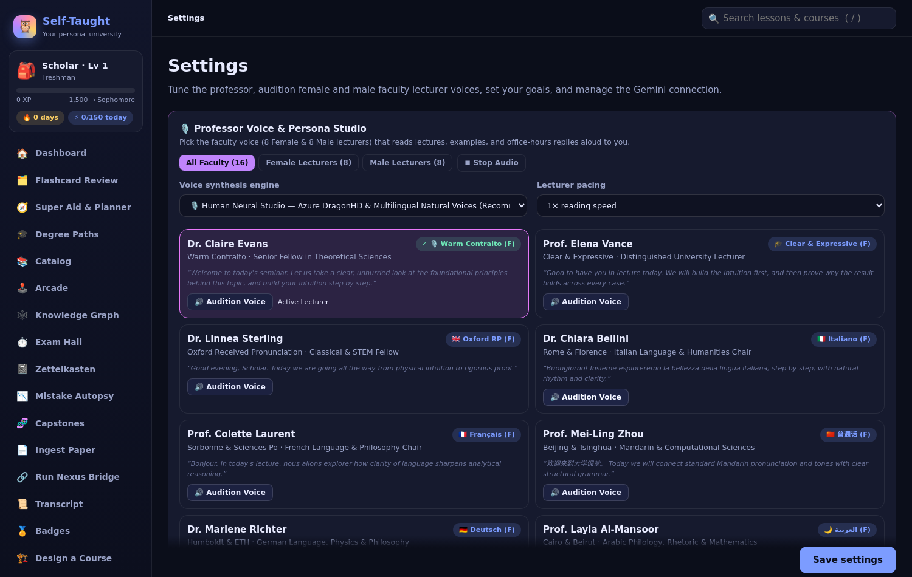

# Self-Taught University — your personal AI university

A full university that runs on your laptop. **25 faculties, 714 courses, 19,000+ lessons**
and **123 degree paths**, hand-built as a structured catalog — then every lesson is
generated live by Gemini for *you*: your name, your preferred professor tone, your depth,
your prior feedback. Interactive simulations, in-browser Python labs, graded homework,
Socratic office hours, oral exams, spaced-repetition flashcards, XP, ranks and badges
turn "I should learn physics someday" into a game you actually finish.



---

## What you get

| | |
|---|---|
| **Catalog** | 25 faculties from Physics and Mathematics to Aerospace, Quantum Computing, Synthetic Biology, Jurisprudence, Geopolitics, Cybersecurity/OSINT and World Languages. 714 courses, 19,342 lessons with prerequisites, 123 B.A./B.S./M.S. degree paths. |
| **Live lessons** | Each lesson is generated on open: lecture sections with checkpoints, worked examples, misconceptions, a sim assignment, a Python lab, 6–10 graded homework problems, glossary, further reading. Cached forever; the next lesson prefetches while you study. |
| **Interactive sims** | 19 hand-written simulation widgets (projectile motion, circuits, chaos, networks, …) embedded in lessons with challenges. |
| **Python labs** | Real Python in the browser via Pyodide (NumPy + SymPy) in a Web Worker — no install, nothing leaves your machine. Labs come with hidden tests. |
| **Grading** | MCQ/numeric graded locally; short answers, code and proofs graded by Gemini against a rubric with feedback. |
| **Professor** | Socratic office-hours chat per lesson, multi-turn *viva voce* oral exams, Feynman-technique drills, "explain this highlight" popovers, 16 neural TTS voices (Edge TTS) with a pronunciation coach. |
| **Memory** | Spaced-repetition flashcards (SRS) auto-built from lessons, Zettelkasten-style note links and a cross-domain prerequisite graph. |
| **Game layer** | XP, daily streaks, ranks from *Freshman* to *Luminary*, badges, test-out exams, conferred degrees on a transcript. |
| **Design your own** | Paste a syllabus or a document → the app drafts a new course in the same schema; or write a `curriculum/<name>.py` by hand. |
| **Offline-first** | Full-text search, import/export of all progress, local SQLite. Only lesson generation and LLM grading call Gemini. |

````carousel

<!-- slide -->

<!-- slide -->

<!-- slide -->

<!-- slide -->

````

---

## Quick start

Requirements: **Python 3.10+**, a modern browser, and a free
[Gemini API key](https://aistudio.google.com/app/apikey) for lesson generation.

```bash
git clone https://github.com/Sockshare/self-taught-university.git
cd self-taught-university
./run.sh
```

`run.sh` creates a local `.venv`, installs three dependencies (Flask, google-genai,
edge-tts) and opens <http://127.0.0.1:8088>. The whole catalog, degree paths, sims,
search and the dashboard work immediately with **no key**; open **Settings** and paste
your Gemini key to start generating lessons (or `export GEMINI_API_KEY=...` first).

Manual equivalent:

```bash
python3 -m venv .venv && . .venv/bin/activate
pip install -r requirements.txt
python server.py
```

### First five minutes

1. **Enrol** — pick a name, professor tone (*playful*, *rigorous*, …) and lesson depth.
2. **Catalog → Physics → Mechanics 101 → Lesson 1.** Generation takes ~1–3 minutes the
   first time; read the lecture, pass the checkpoints, play the sim, run the lab, submit homework.
3. Earn XP, watch the rank bar move, check **Flashcard Review** tomorrow.
4. Not happy with a lesson? **Feedback** tab → "more examples" → regenerate with your notes applied.
5. Want a plan? **Degree Paths** → pick a B.S. → the planner sequences the prerequisites.

---

## Configuration

Everything is optional; see [`.env.example`](.env.example).

| Variable | Default | Purpose |
|---|---|---|
| `GEMINI_API_KEY` | — | Lesson generation, grading, chat. Also settable in-app (stored in local SQLite). A `.env` in the project root or `~/.config/self_taught/.env` is also read. |
| `SELF_TAUGHT_PORT` | `8088` | HTTP port (binds `127.0.0.1`) |
| `SELF_TAUGHT_DB` | `data/self_taught.db` | SQLite location |
| `NEXUS_APPS_JSON` | `~/.config/run_nexus/apps.json` | Optional: link coursework to a local [Run Nexus](https://sockshare.github.io/blackbeard/) tool launcher |

**Models.** `llm.py` tries a chain of Gemini models and falls back automatically
(`gemini-2.5-flash` / `gemini-2.5-flash-lite` are the ones that matter today). Edit the
`FALLBACK_CHAIN` / `FAST_CHAIN` lists to pin a model.

**Offline Python labs.** Pyodide (~42 MB) is loaded from jsDelivr by default. To vendor it
for fully offline use, download the `v0.26.4/full` bundle into `static/vendor/pyodide/`
(the worker checks there first).

---

## Project layout

```
self-taught-university/
├── server.py          Flask API (~60 endpoints) + static SPA host
├── llm.py             Gemini client: model chain, cooldowns, key discovery
├── prompts.py         Lesson / grading / design / viva prompts
├── db.py              SQLite schema: cache, progress, XP, SRS, feedback, chat
├── gamification.py    XP rules, ranks, badges
├── degrees.py         123 degree paths and the planner
├── tts.py             Edge-TTS voices, caching, pronunciation coach
├── curriculum/        25 catalog modules, one DOMAIN dict each
├── static/            SPA (vanilla JS), sims/ (19 widgets), pyworker.js (Pyodide)
├── templates/         index.html
├── tools/             validate_curriculum.py, smoke_sims.sh, headless_check.py
├── docs/CONTRACTS.md  Schemas for catalog, lessons and sim widgets
└── data/              Created at runtime: SQLite DB, TTS cache, custom courses
```

## Adding content

- **New faculty / course:** add `curriculum/<name>.py` exporting `DOMAIN`
  (schema in [`docs/CONTRACTS.md`](docs/CONTRACTS.md) §1), run
  `python tools/validate_curriculum.py curriculum/<name>.py`. Or use **Design a course** in-app.
- **New simulation:** `SelfTaughtSims.register({...})` in `static/sims/<id>.js`
  (§3), add the id to `KNOWN_SIMS` in the validator, reference it from a module's `"sim"`.
- `bash tools/smoke_sims.sh` mounts every widget in headless Chrome and reports runtime errors.

## Privacy

Local Flask server on loopback, local SQLite, local TTS cache. The only network calls are
to Gemini (lesson text, grading, chat — when you have a key), Microsoft Edge TTS (voice
audio, when you press play) and the Pyodide CDN (once, unless vendored). No analytics.

## License

MIT — see [LICENSE](LICENSE). Bundled: KaTeX (MIT), marked (MIT), canvas-confetti (ISC).
Pyodide (MPL-2.0) is fetched at runtime.
